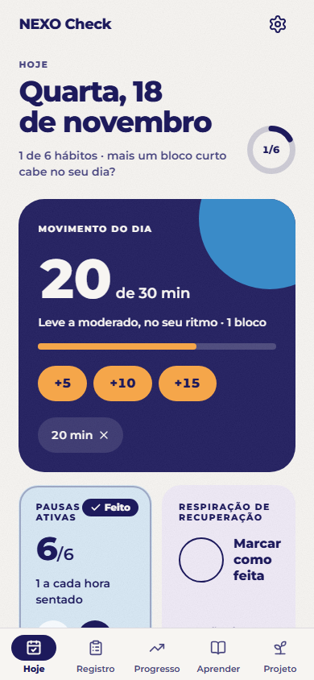
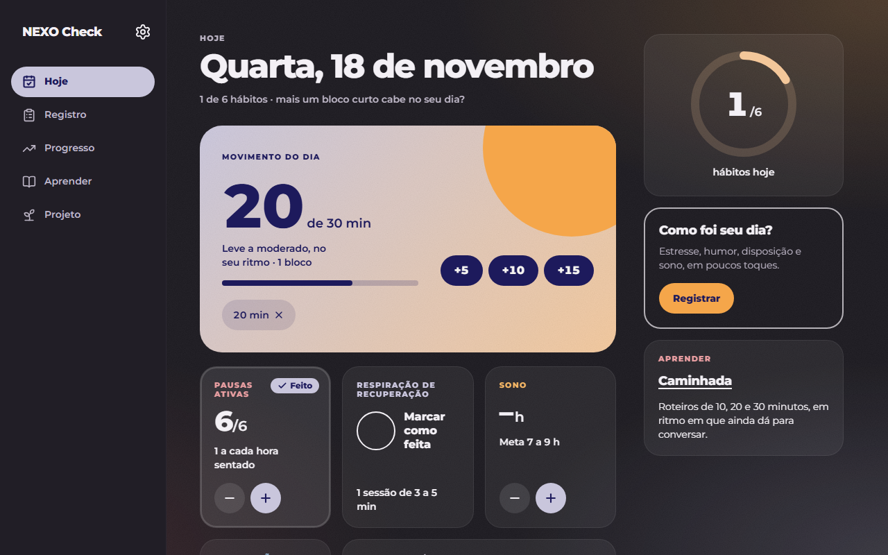
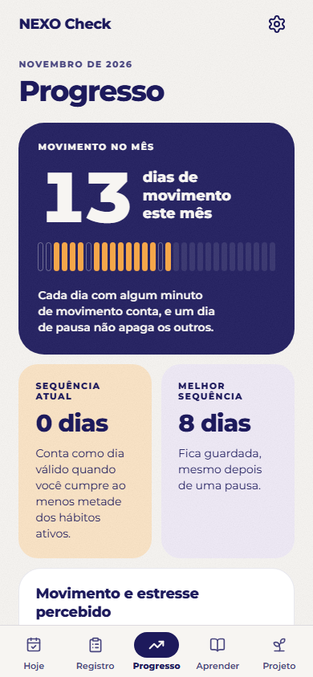
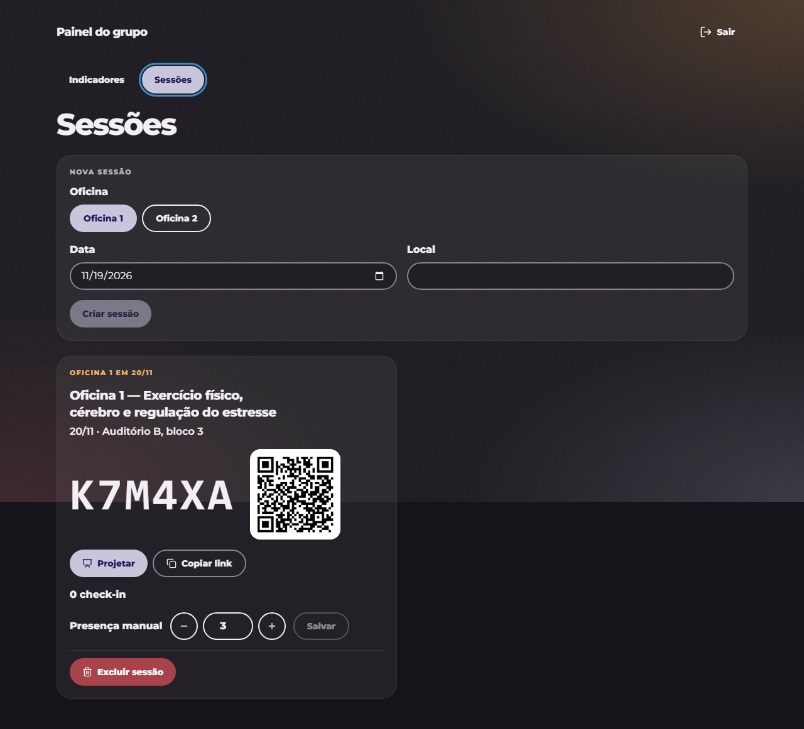

# NEXO Check

Checklist diário de hábitos do projeto **NEXO em Movimento** (neurociência do exercício físico e saúde mental universitária). É um PWA que funciona offline, com sincronização opcional e consentida.

> **Avisos do projeto**
>
> - O app não substitui atendimento profissional. Em caso de sofrimento, procure um serviço de saúde.
> - As atividades devem respeitar os limites de cada pessoa; a intensidade é leve a moderada e pode ser adaptada.
> - O conteúdo usa linguagem cautelosa: o exercício físico "pode contribuir" para o bem-estar e está "associado a" benefícios; o app não promete resultados.
> - Os questionários são **provisórios**, até a aprovação do grupo.

## Links

- App web: <https://nexo-check.vercel.app>
- API (status): <https://nexo-check-api.onrender.com/health>. No plano gratuito do Render, a primeira requisição depois de um tempo parado pode levar cerca de 50 s.

## Telas

| Hoje (claro, celular)                | Hoje (escuro, desktop)                                     |
| ------------------------------------ | ---------------------------------------------------------- |
|  |  |

| Progresso                                | Aprender                               |
| ---------------------------------------- | -------------------------------------- |
|  |  |

Painel do grupo (admin, sessões das oficinas):



## Pré-requisitos

- Node 22+
- pnpm 10 (`corepack enable` ativa a versão fixada em `package.json`)
- Um Postgres para a API (local ou Neon), só se for usar sincronização e painel admin

## Como rodar

```sh
pnpm install
cp apps/api/.env.example apps/api/.env   # preencha os valores (veja a tabela de variáveis)
pnpm dev
```

- Client: http://localhost:5173
- API: http://localhost:3333

O client funciona sem a API (offline-first). A API só é necessária para sincronizar, fazer check-in nas oficinas e usar o painel admin. Na primeira vez, aplique as migrações: `pnpm --filter api db:migrate`.

## Comandos

| Comando          | O que faz                                             |
| ---------------- | ----------------------------------------------------- |
| `pnpm dev`       | Client e API em modo de desenvolvimento               |
| `pnpm build`     | Build de todos os pacotes (Turborepo)                 |
| `pnpm lint`      | ESLint (flat config)                                  |
| `pnpm typecheck` | TypeScript estrito em todos os pacotes                |
| `pnpm test`      | Testes unitários e de integração (Vitest)             |
| `pnpm test:e2e`  | Testes de ponta a ponta e acessibilidade (Playwright) |
| `pnpm format`    | Prettier                                              |

Os commits seguem Conventional Commits (commitlint + Husky).

## Arquitetura

Monorepo pnpm + Turborepo, TypeScript estrito.

| Pasta             | Conteúdo                                                                          |
| ----------------- | --------------------------------------------------------------------------------- |
| `apps/client`     | PWA em React + Vite                                                               |
| `apps/api`        | API em Fastify + Prisma + Postgres                                                |
| `packages/shared` | `@nexo/shared`: regras, constantes, schemas e conteúdo (consumido como código TS) |
| `packages/ui`     | `@nexo/ui`: componentes e tokens visuais                                          |
| `docs/`           | Documentação, especificações e planos                                             |

- **Offline-first:** os dados ficam no dispositivo (IndexedDB via Dexie). Mudanças feitas com sincronização ativa entram numa fila de saída (outbox) e são enviadas quando há conexão.
- **Sincronização:** `POST /sync` envia as mudanças e o cliente busca as novas por cursor. Os conflitos são resolvidos por _last-write-wins_, com limite de diferença de relógio (`MAX_CLOCK_SKEW_MS`).
- **API:** Fastify com Prisma (Postgres). Os participantes se identificam por um código; as rotas de sincronização exigem esse participante autenticado.
- **Admin:** login por senha (`ADMIN_PASSWORD`) que emite um JWT (`ADMIN_JWT_SECRET`) para o painel: sessões das oficinas com QR e código, indicadores agregados e exportação CSV.

## Privacidade

- Os dados são **pseudonimizados**: o participante é identificado por um código, não por nome.
- Sem consentimento, nenhum dado do participante sai do dispositivo. A sincronização só começa depois do aceite.
- Texto livre (nota do dia e respostas de tipo `text`) **nunca** é enviado ao servidor; o servidor também o descarta se receber.
- Itens da LGPD, pendentes de revisão do grupo:
  - Responsável pelos dados: `[RESPONSÁVEL PELOS DADOS]`
  - Contato: `[CONTATO]`
  - Prazo de guarda: `[PRAZO DE GUARDA]`

## Implantação

Ordem sugerida: Neon, Render, Vercel e, por fim, ajustar o CORS no Render.

### 1. Banco (Neon)

1. Crie o projeto `nexo-check` na região **aws-us-east-1** (perto do Render "virginia").
2. Copie a URL **com pooler** para `DATABASE_URL`.
3. Copie a URL **direta** (sem pooler) para `DIRECT_URL`; ela é usada só pelas migrações.

### 2. API (Render)

1. Em **New > Blueprint**, aponte para este repositório. O `render.yaml` cria o serviço `nexo-check-api` (plano gratuito, região virginia).
2. Preencha no painel as variáveis com `sync: false`: `DATABASE_URL`, `DIRECT_URL`, `ADMIN_PASSWORD`, `CORS_ORIGINS`, `PUBLIC_WEB_URL`. O `ADMIN_JWT_SECRET` é gerado pelo Render.
3. As migrações rodam no `startCommand` (`prisma migrate deploy`), porque o plano gratuito não tem pre-deploy.
4. O health check é `/health`.

> O plano gratuito hiberna após um período sem uso: a primeira requisição depois disso pode levar cerca de um minuto (cold start). O client segue funcionando offline nesse intervalo.

### 3. Client (Vercel)

| Campo            | Valor                               |
| ---------------- | ----------------------------------- |
| Root Directory   | `apps/client`                       |
| Framework        | Vite                                |
| Install Command  | `pnpm install --frozen-lockfile`    |
| Build Command    | `pnpm turbo build --filter client`  |
| Output Directory | `dist`                              |
| Variável         | `VITE_API_URL` = URL pública da API |

O `apps/client/vercel.json` já configura o fallback de SPA e o cache dos assets.

### 4. Fechar o ciclo

Com o domínio da Vercel definido, volte ao Render e ajuste `CORS_ORIGINS` e `PUBLIC_WEB_URL` para esse domínio (sem barra final). Depois faça um redeploy da API.

## Variáveis de ambiente

API (`apps/api/.env`, modelo em `apps/api/.env.example`):

| Variável           | Obrigatória | Descrição                                                    |
| ------------------ | ----------- | ------------------------------------------------------------ |
| `DATABASE_URL`     | sim         | Conexão com o Postgres (use a URL com pooler em produção)    |
| `DIRECT_URL`       | não         | Conexão direta, usada só pelas migrações (se usar pooler)    |
| `ADMIN_PASSWORD`   | sim         | Senha do painel admin (mínimo 12 caracteres)                 |
| `ADMIN_JWT_SECRET` | sim         | Segredo do JWT do admin (mínimo 32 caracteres)               |
| `CORS_ORIGINS`     | não         | Origens permitidas no CORS, separadas por vírgula            |
| `PUBLIC_WEB_URL`   | sim         | URL pública do client (usada nos links e QR das sessões)     |
| `PORT`             | não         | Porta da API (padrão 3333)                                   |
| `TRUST_PROXY_HOPS` | não         | Saltos de proxy confiáveis (padrão 1; Render = 1)            |
| `NODE_ENV`         | não         | `development`, `test` ou `production` (padrão `development`) |

Client:

| Variável       | Obrigatória | Descrição                                                      |
| -------------- | ----------- | -------------------------------------------------------------- |
| `VITE_API_URL` | em produção | URL da API (padrão `http://localhost:3333` em desenvolvimento) |

Nunca versione arquivos `.env`; só o `.env.example`.

## Fase B (planejada)

Ainda não implementadas nesta versão:

- Versão Windows (desktop)
- Versão Android
- Releases publicadas

## Documentação

Especificações e planos em `docs/superpowers/`; material de origem em `docs/origem/`.
